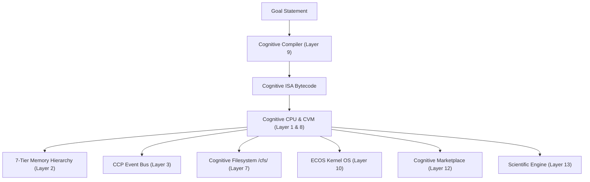
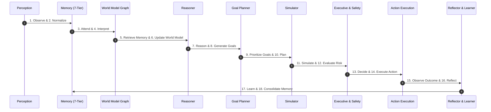
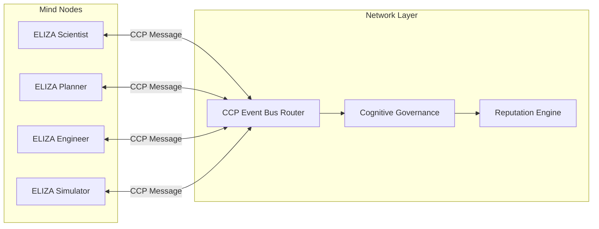
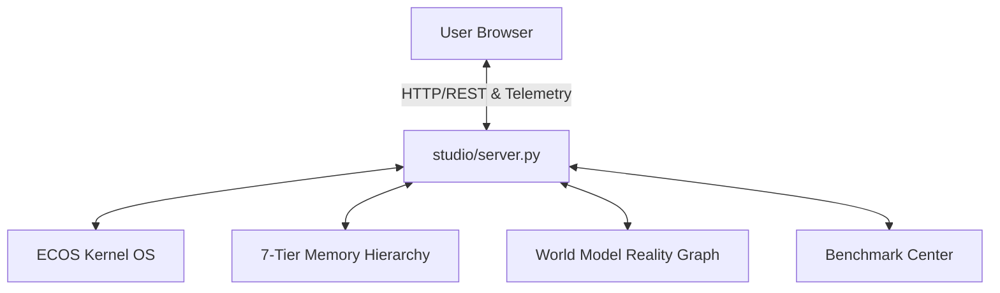

# E.L.I.Z.A Architecture Diagrams

> **Status**: Canonical System Architecture Maps & Sequence Flows

---

## 1. System High-Level Architecture (The 11 Layers)

---

## 2. The 19-Stage Cognitive Pipeline

---

## 3. Cognitive Civilization P2P Network Architecture

---

## 4. ELIZA Studio v0.1 Control Deck Architecture

